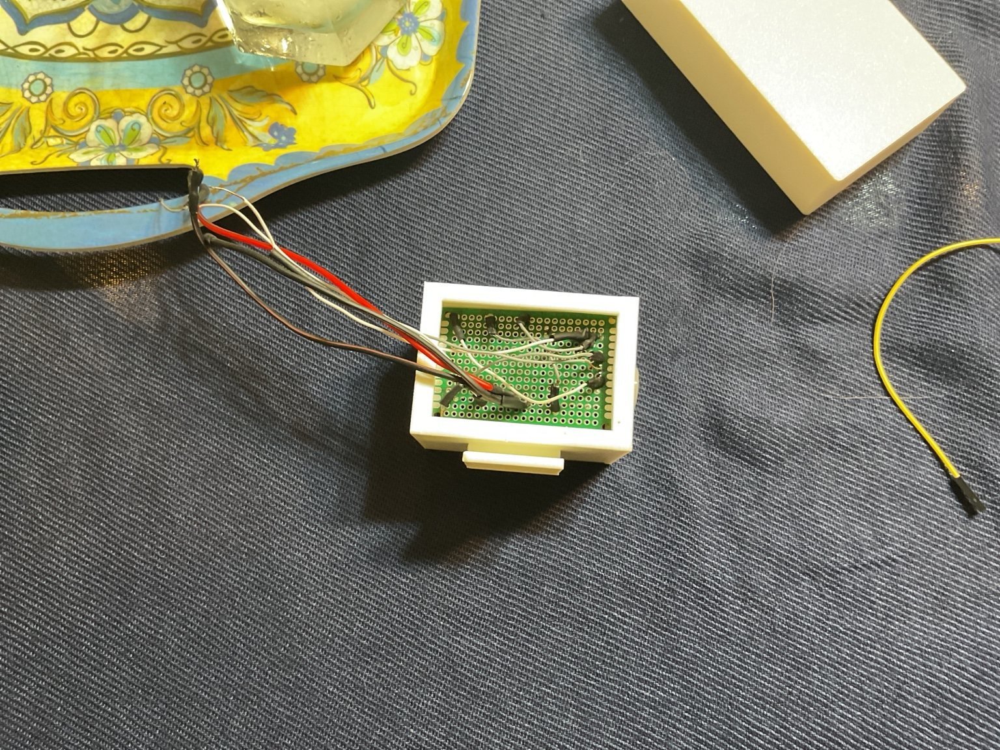
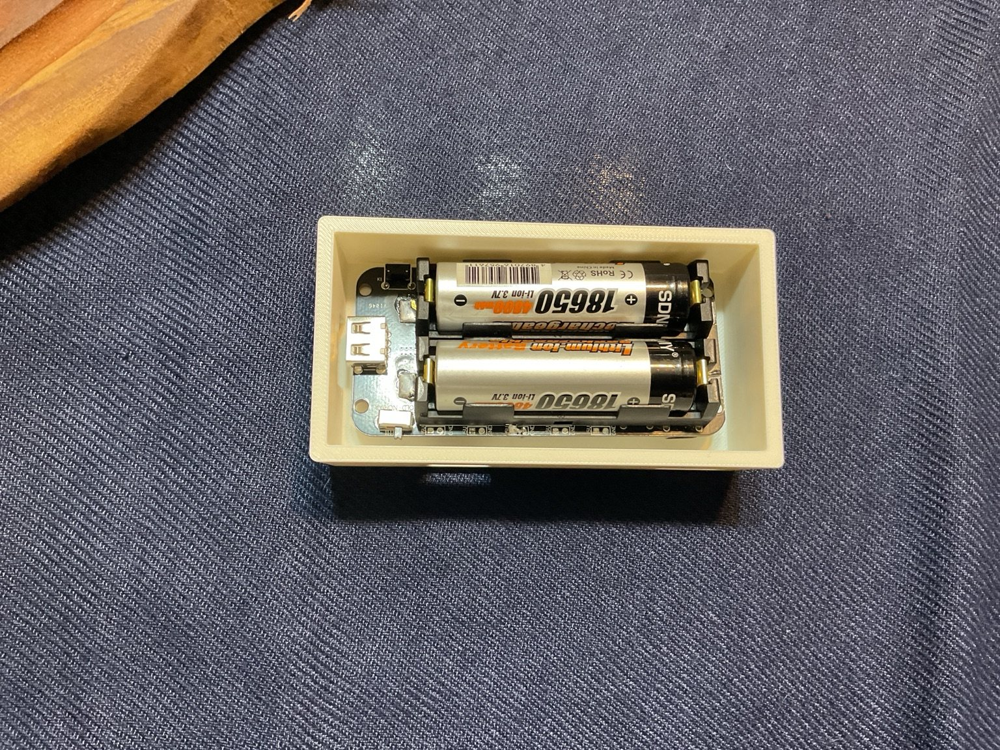
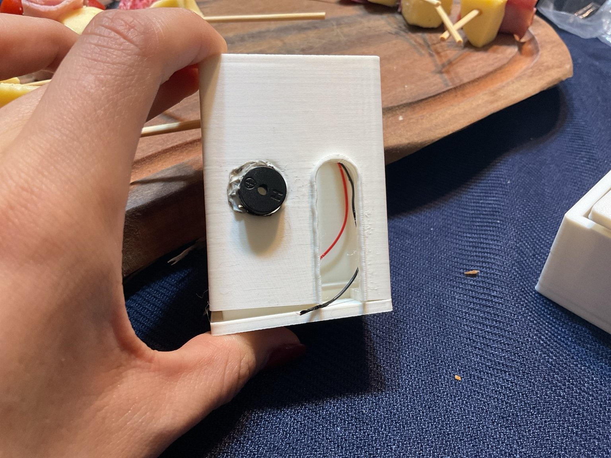

# Documentación del rediseño físico — CAMI

## Cambios respecto de la versión anterior

- Se sustituyó el sensor **MQ-135** por el **MQ-7**.
- Se modificaron conexiones electrónicas respecto del circuito anterior.
- El diseño físico pasó de una carcasa principal a **tres carcasas impresas en 3D**.
- El firmware compartido incorpora un dashboard web local y rutinas de comunicación con ThingSpeak.

## Caja 1: control y sensor

La primera carcasa contiene una placa ESP32 sobre placa perforada y cableado de interconexión. Según el equipo, corresponde al módulo del sensor MQ-7 y control. Tiene tapa y un elemento de sujeción al casco. La función exacta de cada cable debe verificarse con el diagrama actualizado.

## Caja 2: alimentación

La segunda carcasa aloja dos celdas recargables tipo 18650, en un portabaterías con placa electrónica y conectores accesibles por aberturas. Cuenta con tapa desmontable. **A la fecha de las fotografías, no estaba resuelta su fijación definitiva al casco.** La capacidad impresa en las celdas no constituye una medición verificada.

## Caja 3: alertas

La tercera carcasa está destinada al buzzer y a las luces indicadoras. Presenta aberturas para montaje y cableado. Según el registro del equipo, las luces todavía no estaban instaladas al momento de las fotografías y quedaba pendiente confirmar la instalación final del interruptor.

## Software disponible

El archivo `CAMI_FINAL_GITHUB.ino` incluye, a nivel de implementación de código:

- Lectura analógica y filtrado del sensor MQ-7 en la ESP32.
- Estados normal, prealerta y alerta según aumento de señal ADC y una referencia experimental.
- Control de luces y buzzer.
- Página web local alojada en la ESP32 y servida en `192.168.4.1` al conectarse a su red AP.
- Rutinas de registro CSV local y envío periódico de voltaje, ADC y estado a ThingSpeak.

**No se afirma que todas estas funciones hayan sido verificadas en hardware.** El sensor no está calibrado en ppm ni se controla en este firmware el ciclo térmico requerido para mediciones fiables del MQ-7. No es un detector de seguridad personal.

## Pendientes técnicos y de evidencia

1. Confirmar conexiones definitivas y actualizar el diagrama electrónico anterior.
2. Revisar alimentación y protecciones de las baterías, compatibilidad del buzzer y tensiones del sensor.
3. Terminar montaje de LEDs, interruptor y fijación de las cajas al casco.
4. Adjuntar los archivos nativos de Fusion 360 y planos acotados si se consiguen.
5. Registrar resultados de pruebas **realmente ejecutadas** (fotos, mediciones, errores y correcciones).
6. Comprobar, si corresponde, la transmisión de datos desde la ESP32 a ThingSpeak.
