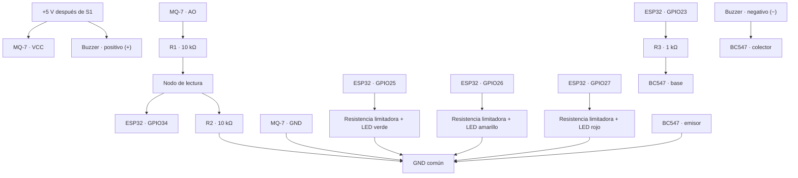

# CAMI — Diagrama de conexiones del circuito

## Descripción

El prototipo CAMI utiliza una placa **ESP32 DevKit V1** para leer la señal analógica de un sensor **MQ-7**, activar un semáforo de tres LED y controlar una alarma sonora mediante un transistor **BC547**.

**Referencia de software:** `CAMI_FINAL_GITHUB.ino`.

> **Estado del documento:** conexiones documentadas según el firmware y los antecedentes del proyecto. No constituyen una comprobación física del cableado. El esquemático eléctrico final debe contrastarse con el prototipo real.

## Tabla de conexiones

| Componente | Terminal | Conexión |
|---|---|---|
| Sensor MQ-7 | VCC | +5 V después del interruptor S1 |
| Sensor MQ-7 | GND | GND común |
| Sensor MQ-7 | AO | Resistencia R1 de 10 kΩ, luego nodo de lectura hacia GPIO34 |
| Sensor MQ-7 | DO | Sin conexión |
| Divisor de tensión | R1, 10 kΩ | Entre AO del MQ-7 y nodo de lectura del GPIO34 |
| Divisor de tensión | R2, 10 kΩ | Entre nodo de lectura del GPIO34 y GND |
| LED verde | Señal de control | GPIO25, con resistencia limitadora de corriente en serie |
| LED amarillo | Señal de control | GPIO26, con resistencia limitadora de corriente en serie |
| LED rojo | Señal de control | GPIO27, con resistencia limitadora de corriente en serie |
| LED (retorno común) | Negativos | GND común |
| Buzzer | Positivo (+) | +5 V después del interruptor S1 |
| Buzzer | Negativo (−) | Colector del transistor BC547 |
| Transistor BC547 | Base | GPIO23 a través de R3 de 1 kΩ |
| Transistor BC547 | Emisor | GND común |

## Esquema funcional de conexiones

**Nota:** el gráfico anterior es un **diagrama funcional de cableado**, no un esquemático eléctrico normalizado.

## Conexión entre placas

Según el diseño documentado, se requieren **seis conductores** entre los módulos del montaje: **5 V, GND, GPIO25, GPIO26, GPIO27 y GPIO23**.

## Verificaciones pendientes antes de cerrar el esquema eléctrico

1. Confirmar en el prototipo la fuente de alimentación, el cableado del interruptor S1 y el modo de alimentar la ESP32.
2. Confirmar el voltaje y consumo del buzzer y la compatibilidad del transistor BC547.
3. Verificar la orientación real de los terminales colector, base y emisor del BC547 según la pieza utilizada.
4. Verificar que la entrada GPIO34 no supere el voltaje permitido de la ESP32; **el divisor de 10 kΩ/10 kΩ reduce la señal AO a la mitad**, pero esto debe comprobarse.
5. Confirmar las resistencias limitadoras de corriente y la polaridad de cada LED.
6. Comparar el esquema final con el cableado físico y con `CAMI_FINAL_GITHUB.ino`.

## Archivo pendiente

La versión final del **esquemático eléctrico completo** se incorporará a esta carpeta cuando se termine y valide con el montaje real. Este documento sirve para registrar las conexiones y facilitar esa elaboración, pero **no reemplaza el esquemático eléctrico solicitado**.
