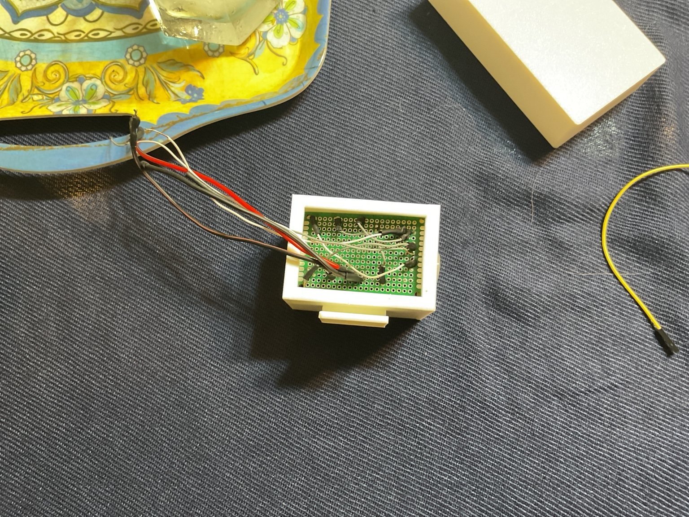
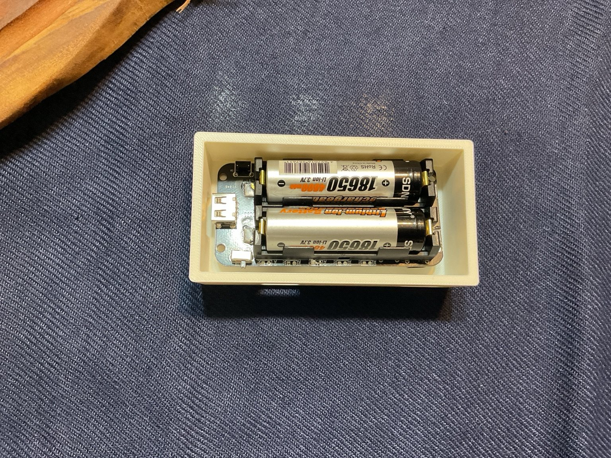
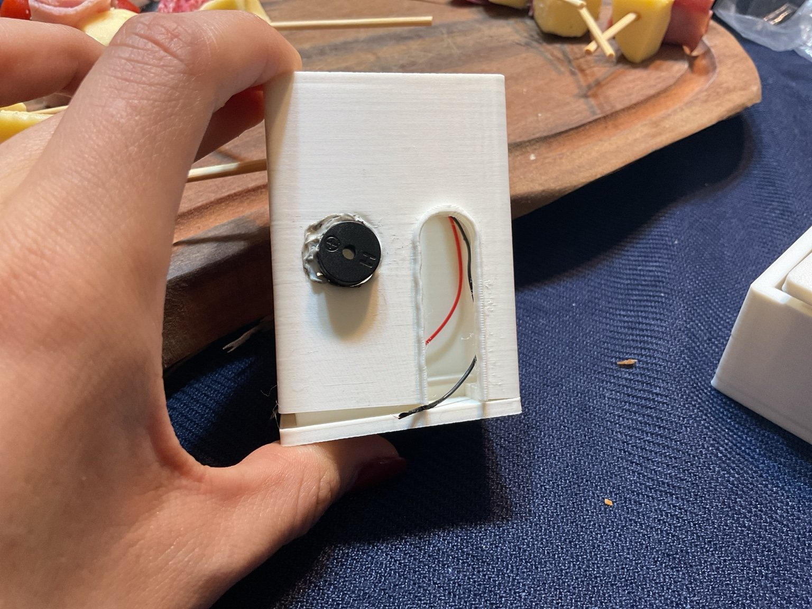

# CAMI — Casco de Ayuda Minera Inmediata

**Proyecto académico — Taller de Introducción a la Ingeniería (TEI201)**

**Equipo:** Mariana Ascanio, Antonia Briceño, Emilia Echavarría, Ainara Felix y Andrés Obreque.

## Problema y objetivo

La exposición a monóxido de carbono (CO) en entornos mineros subterráneos representa un riesgo para la salud. CAMI propone un prototipo de casco con señalización visual y sonora que reacciona a cambios de la señal de un sensor de gas. El proyecto se relaciona con los ODS 3 (Salud y bienestar) y 8 (Trabajo decente y crecimiento económico).

**Alcance:** Es un prototipo educativo. Las lecturas actuales son señales experimentales del sensor **MQ-7**, **no concentraciones calibradas de CO en ppm**. No sustituye detectores de seguridad certificados ni debe usarse para decidir si un ambiente es seguro.

## Actualización del prototipo

En la etapa reciente se reemplazó el **MQ-135 por el MQ-7**, se revisaron las conexiones y se rediseñó el encapsulado: ahora hay **tres cajas impresas en 3D**.

| Módulo | Componentes / propósito | Estado documentado |
|---|---|---|
| Caja 1 — Control | ESP32, placa perforada y conexiones del sistema MQ-7 | Carcasa física fotografiada, con soporte para casco |
| Caja 2 — Alimentación | Dos baterías 18650, portabaterías con placa electrónica y tapa desmontable | Caja física fotografiada; fijación definitiva al casco pendiente |
| Caja 3 — Alertas | Buzzer, espacio para luces LED e interruptor | Caja física fotografiada; luces aún no instaladas al momento de las fotos |

### Evidencia fotográfica del prototipo

**Caja 1 — Control**



**Caja 2 — Alimentación**



**Caja 3 — Alertas**



## Firmware y alertas

El archivo [`CAMI_FINAL_GITHUB.ino`](CAMI_FINAL_GITHUB.ino) contiene una versión del firmware ESP32 para el montaje actualizado. Incluye lectura del MQ-7, filtrado, lógica de tres estados, control de luces y buzzer, un servidor web local y rutinas de almacenamiento y envío a ThingSpeak. **Su funcionamiento completo en el prototipo no se da por validado únicamente por estar programado.**

- Verde: estado normal según la referencia experimental.
- Amarillo: prealerta por aumento de señal.
- Rojo: alerta por aumento mayor de señal, con aviso sonoro.
- Los umbrales están expresados en **unidades ADC**, no en ppm de CO.

El firmware contempla un dashboard **local** accesible, al conectarse al punto de acceso de la ESP32, mediante `http://192.168.4.1`, y un dashboard **remoto** de ThingSpeak.

### ThingSpeak

Canal CAMI: **3571982**. Los campos previstos son:

1. **Field 1:** voltaje de la salida analógica del sensor (V).
2. **Field 2:** lectura ADC del sensor.
3. **Field 3:** estado experimental (0 = normal, 1 = prealerta, 2 = alerta).

Las capturas de configuración y pruebas manuales están en [`docs/`](docs/). Estas pruebas con datos simulados **no demuestran** que se haya completado la conexión real ESP32 → ThingSpeak. El envío requiere Wi-Fi de 2,4 GHz con acceso a internet y una Write API Key válida.

### Configuración antes de cargar a la ESP32

En una **copia local y privada** de `CAMI_FINAL_GITHUB.ino`, configurar:

```cpp
const char WIFI_SSID[] = "NOMBRE_RED_2_4_GHZ";
const char WIFI_CLAVE[] = "CLAVE_WIFI";
const char THINGSPEAK_WRITE_KEY[] = "CLAVE_PRIVADA_VIGENTE";
```

**No publicar credenciales reales en GitHub.** Si una clave ya fue compartida públicamente, regenerarla en ThingSpeak. El firmware incluye conexiones y supuestos eléctricos que deben contrastarse con el montaje real antes de energizarlo, en especial el buzzer, la alimentación del MQ-7 y el divisor de voltaje del ADC.

## Diseño 3D y estado del desarrollo

Se fabricaron tres carcasas impresas en 3D con tapas y aberturas para los componentes. Las fotografías anteriores muestran el resultado físico. Los archivos nativos de Fusion 360 y los planos acotados deben incorporarse cuando estén disponibles; las imágenes del diseño anterior en el repositorio no representan necesariamente las tres cajas nuevas.

## Documentación y fuentes

- [`DOCUMENTACION_ACTUALIZADA.md`](DOCUMENTACION_ACTUALIZADA.md): módulos, cambios y estado de integración.
- [`FUENTES.md`](FUENTES.md): herramientas, bibliotecas y uso de IA.
- [`docs/`](docs/): capturas del dashboard ThingSpeak realizadas previamente.

**Estado de entrega:** repositorio documental del prototipo. Las verificaciones eléctricas, de transmisión y de funcionamiento deben respaldarse con resultados reales antes de declararse completadas.
